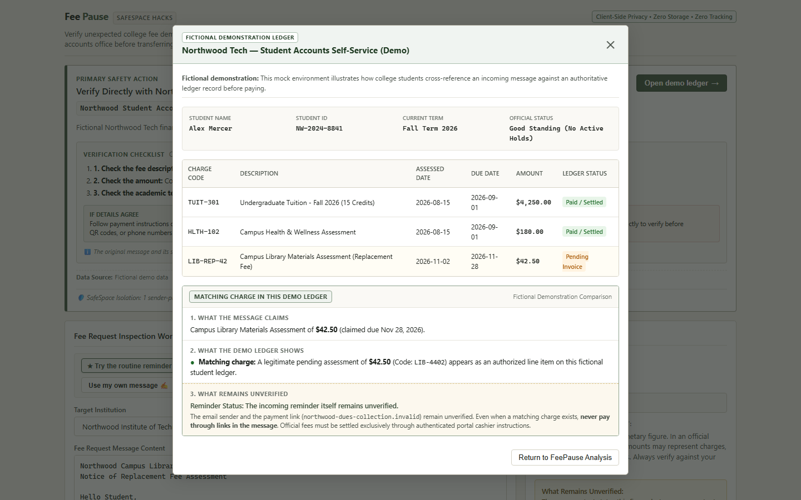
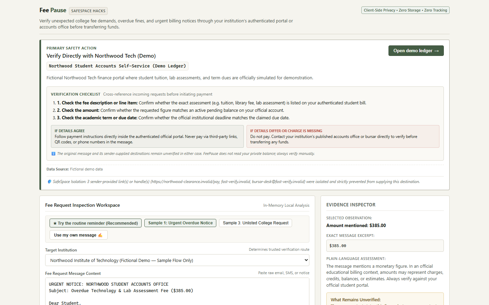

# FeePause

> Help college students verify unexpected fee requests through their institution’s official student portal or accounts office before paying.

**Live Application Demo:** [https://rhythm-sanghi.github.io/FeePause/](https://rhythm-sanghi.github.io/FeePause/)  
**GitHub Repository:** [https://github.com/Rhythm-Sanghi/FeePause](https://github.com/Rhythm-Sanghi/FeePause)  
Built for **SafeSpace Hacks** (evaluated on Safety Benefit, Practical Functionality, Trust & Responsible Design, and Clarity & User Experience).



---

## The Problem & Real-World Background

College students are frequent targets of fraudulent or unauthorized fee communications: unexpected lab assessments, sudden graduation clearance demands, overdue library notices, and fake enrollment holds. These messages weaponize artificial urgency—threatening course de-registration or academic holds within hours—to rush students into sending payments via external gateways, wire transfers, UPI, peer-to-peer handles, or gift cards.

This reality is documented by university advisories and billing guidance:
- **University Fee Fraud Advisories:** UC Berkeley warns students about fake tuition payment requests and unexpected messages claiming there is a problem with their registration or student account. See [UC Berkeley Information Security Office: Back-to-School Cybersecurity Tips](https://security.berkeley.edu/back-school-cybersecurity-tips).
- **Where Students Check Authentic Charges:** Official first-party billing instructions—such as [UC Berkeley Student Central: Understanding Your Student Bill](https://studentcentral.berkeley.edu/billing-fees-payments/billing/)—direct students to log into **CalCentral (`calcentral.berkeley.edu`)** and inspect **My Finances → Billing Summary → View Transactions** to confirm authentic institutional charges before making any payment.
- **Continuing Student Fee Guidelines:** IIT Delhi’s 2026–27 first-semester circular directs continuing students to eCampus Student Corner for the semester fees covered by that circular. See the [IIT Delhi 2026–27 First-Semester Fee Circular](https://academics.iitd.ac.in/wp-content/uploads/2026/07/FEE-CIRCULAR-FOR-CONTINUING-STUDENTS-FOR-THE-1ST-SEMESTER-OF-ACADEMIC-YEAR-2026-27-SHEKHARTHAK170620-updated_compressed.pdf) published under [IIT Delhi Academic Circulars](https://academics.iitd.ac.in/circulars/).

Existing security tools often try to predict "scam probabilities" or award false-sense-of-security "safe to pay" badges using probabilistic AI text models. But phishing messages can look pristine, and genuine university emails can look rushed or unpolished. **Text in an incoming message can never prove whether an invoice actually exists on an institutional ledger.**

FeePause operates on a foundational safety premise: **Never guess authenticity. Instead, guide the student directly to their institution's official student portal or accounts office to inspect their authenticated ledger before any payment is made.**

---

## 30-Second Judge Walkthrough

1. **One-Click Demo Entry:** Click **"★ Try the routine reminder"** in the unified entry strip (or click **"Use my own message ✍️"** to check your own fee notice with real college verification).
2. **Review Extracted Observations:** FeePause deterministically detects observable facts—such as claimed amounts (supporting Indian-grouped `₹1,25,000`, Western-grouped `$1,250,000`, and plain sums), stated deadlines, external links, and credential mentions.
3. **Inspect Evidence:** Selecting an observation in the workspace updates the **Evidence Inspector** with the exact excerpt, plain-language risk assessment, and why message content alone cannot prove an institutional balance.
4. **Primary Safety Action & Checklist:** Look at the top banner. FeePause gives highest visual hierarchy to the independent verification route with an embedded 3-step checklist (1. check description/line item, 2. check amount, 3. check academic term/due date) and explicit next steps.
5. **Open Demo Ledger:** Click **"Open demo ledger →"** to inspect fictional Northwood Tech's simulated accounts ledger:
   - **For the Routine Reminder:** Displays three compact rows:
     1. *What the message claims:* Campus Library Materials Assessment of $42.50.
     2. *What the demo ledger shows:* **Matching charge in this demo ledger** ($42.50 pending balance).
     3. *What remains unverified:* **Reminder Status: The incoming reminder itself remains unverified.** Even with a matching charge, students must pay exclusively through authenticated portal cashier instructions, never through links in the message.
   - **For the Urgent Notice:** Click **"Urgent notice"**. The demo ledger displays three compact rows with **"No corresponding charge shown"** and explains that a missing entry calls for follow-up with the accounts office.
   - **For Custom / Edited Text:** Displays **"No demo result for this message"** while keeping the college verification route available. Fictional sample results are never inherited by arbitrary user input.
6. **Try Custom Text:** Click **"Use my own message ✍️"** or paste text. Northwood is scoped to demo samples, routing personal checks to authentic college portals or unlisted protocols. Notice that editing text immediately clears previous findings and displays **"Message changed. Check again."** while keeping the institutional verification banner active.

---

## Privacy and Verification Design

- **No Scam Scores or Probability Verdicts:** FeePause strictly avoids generating authenticity percentages or "safe to pay" badges. Observable facts are presented plainly, directing verification to authoritative ledgers.
- **Destination Isolation:** Links, phone numbers, and peer payment handles found inside message text are never used as verification routes. Official routes are drawn exclusively from verified institutional records.
- **Private by Design:** All text analysis runs entirely in ephemeral client memory. User input is never written to `localStorage`, `sessionStorage`, cookies, URLs, server logs, or outgoing network requests.
- **Accessible Keyboard Interaction:** Observation items are native `<button>` elements with visible focus styling. The synthetic portal modal is an accessible dialog featuring automatic focus entry, a focus trap, Escape key dismissal, and guaranteed focus restoration to the opener control.
- **Fictional Demonstration Ledger:** An in-app mock environment for *fictional Northwood Institute of Technology* demonstrates how students cross-reference incoming demands against actual institutional ledger records. Northwood data is strictly labeled fictional demo data with no external `.invalid` guidance links.
- **Manual Protocol for Unlisted Colleges:** For institutions not pre-registered in FeePause, the app provides a step-by-step verified search protocol using existing authenticated bookmarks or institutional top-level domains—never guessing URLs or contacts.
- **Threadmark-Inspired Design:** Built with the restrained density of the Threadmark interface (`#F5F4EE` warm canvas, `#1C211C` deep ink, `#455D45` olive accent, monospace domain formatting, and an evidence inspector column).

---

## Screenshots

### Routine Reminder: Matching Charge on Demo Ledger & Unverified Reminder Status (Three Compact Rows)


### Desktop Core Judge Flow & Evidence Inspector


### Mobile View (390px Stacked Responsive Layout with Instant Quick-Start Bar)


---

## Quickstart & Verification Commands

### Prerequisites
- Node.js (>= 18.0.0)
- npm (>= 9.0.0)

### 1. Install Clean Dependencies
```bash
npm ci
```

### 2. Run Lint Check
```bash
npm run lint
```

### 3. Run Typecheck & Production Build
```bash
npm run build
```

### 4. Run Unit Tests (Vitest)
```bash
npm run test
```
*Runs 29 unit tests across 3 suites validating deterministic extraction (Indian digit grouping, Western grouping, credentials vs. neutral mentions, neutral links vs. payment routes, stated deadlines), destination isolation invariants, privacy boundaries, fictional college metadata constraints, and all 12 accuracy regression cases.*

### 5. Run End-to-End & Functional Tests (Playwright)
```bash
npm run test:e2e
```
*Runs 18 Playwright tests covering judge sample flows, three compact comparison rows, single visible routine entry strip, personal-message entry point, real-college verification checklist, keyboard accessibility & focus restoration, stale state warnings ("Message changed. Check again."), real-college portal links (IIT Delhi & UC Berkeley), unlisted college fallback, zero storage/network marker leak audits, and screenshot capture.*

### 6. Start Local Development Server
```bash
npm run dev
```
Preview at `http://localhost:5173`.

---

## Limitations

FeePause cannot authenticate the sender or inspect a student’s private fee balance. Incoming emails, SMS headers, and letterheads can be mimicked. Even when a message contains no suspicious markers, students must confirm whether a fee is actually listed on their authenticated student portal or consult the campus accounts office directly before transferring funds.

---

## Credits & Acknowledgments

- **Lead Engineer & Product Designer:** Rhythm Sanghi
- **Competition:** Built for SafeSpace Hacks
- **Design Influence:** Interface structure and design language adapted from [Threadmark](https://github.com/Rhythm-Sanghi/Threadmark)
- **Assistance:** Engineered with Google Antigravity
