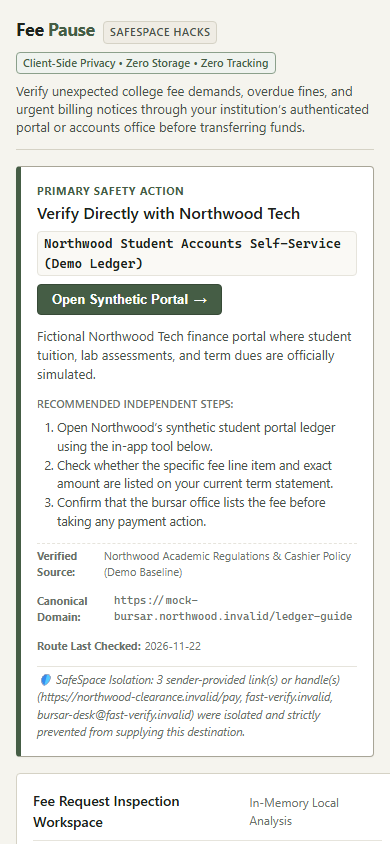

# FeePause

> Help college students verify unexpected fee requests through their institution’s authenticated portal or accounts office before paying.

**Live Application Demo:** [https://rhythm-sanghi.github.io/FeePause/](https://rhythm-sanghi.github.io/FeePause/)  
**GitHub Repository:** [https://github.com/Rhythm-Sanghi/FeePause](https://github.com/Rhythm-Sanghi/FeePause)  
Built for **SafeSpace Hacks** (evaluated on Safety Benefit, Practical Functionality, Trust & Responsible Design, and Clarity & User Experience).


---

## The Problem

College students are frequent targets of fraudulent or deceptive fee communications: urgent lab fees, sudden graduation clearance demands, overdue library penalties, and fake tuition holds. These messages weaponize artificial urgency—threatening course de-registration or academic suspension within hours—to induce panic transfers via external gateways, UPI, peer-to-peer handles, or gift cards.

Existing anti-phishing tools often try to predict "scam probability" or award false-sense-of-security "safe to pay" badges based on AI text analysis. But phishing emails can be polished, and genuine university notices can be poorly phrased. **Message text alone can never prove whether an invoice actually exists on an institutional ledger.**

FeePause was built on a fundamental safety premise: **Never guess authenticity. Instead, guide the student directly to their institution's authenticated portal or bursar office to check their ledger before any payment is made.**

---

## 30-Second Judge Walkthrough

1. **Load a Sample:** Click **"Sample 1: Urgent Overdue Notice"** to populate a realistic urgent fee demand.
2. **Review Extracted Observations:** FeePause deterministically detects the claimed amount (`$385.00`), the 3-hour deadline, the external link, and the OTP authorization request.
3. **Inspect Evidence:** Selecting an observation in the workspace updates the **Evidence Inspector** with the exact text excerpt, a plain-language explanation, and a statement of what remains unverified.
4. **Primary Safety Action:** Look at the top banner. FeePause prioritizes the independently sourced institutional route (**Northwood Student Accounts Self-Service**). Sender-supplied links and handles are strictly isolated.
5. **Open Synthetic Portal:** Click **"Open Synthetic Portal →"**:
   - For **Sample 1 (Urgent Notice)**: Demonstrates **"No matching charge in this demo ledger"**—the official student ledger shows zero pending fees and zero active holds. While a missing ledger entry does not prove a message is fake, students should never pay an unverified fee before confirming with the accounts office.
   - For **Sample 2 (Routine Reminder)**: Demonstrates **"Matching charge in this demo ledger"**—the $42.50 assessment appears on the ledger, but **the incoming reminder itself remains unverified**; payment must occur through the portal's cashier instructions, not the email's link.
   - For **Custom / Edited Text**: Explicitly displays **"No demo result for this message"** while keeping the college verification route available.
6. **Try Custom Text or Other Samples:** Paste any custom message, or click **"Sample 2: Routine Fee Reminder"** or **"Sample 3: Unlisted College Request"** (tests the safe manual fallback protocol).

---

## Core Capabilities & Safety Guarantees

- **No Scam Scores or Verdicts:** FeePause strictly avoids generating authenticity percentages or "safe to pay" badges. Observable facts are presented plainly, directing verification to authoritative ledgers.
- **Destination Isolation:** Links, phone numbers, and peer payment handles found inside message text are never used as verification routes. Sourced destinations are drawn exclusively from verified institutional records.
- **Private by Design:** All text analysis runs entirely in client memory. User input is never written to `localStorage`, `sessionStorage`, cookies, URLs, logs, or outgoing network requests.
- **Synthetic Demonstration Portal:** A dedicated in-app mock environment for *Northwood Institute of Technology* demonstrates how students cross-reference incoming demands against actual institutional ledger records.
- **Manual Protocol for Unlisted Colleges:** For institutions not pre-registered in FeePause, the app provides a step-by-step verified search protocol using existing authenticated bookmarks or institutional top-level domains—never guessing URLs or contacts.
- **Threadmark-Inspired Design:** Built with the restrained density of the Threadmark interface (`#F5F4EE` warm canvas, `#1C211C` deep ink, `#455D45` olive accent, monospace domain formatting, and an evidence inspector column).

---

## Screenshots

### Synthetic Portal (Case 1: Matching Fee on Ledger)


### Mobile View (390px Stacked Layout)


---

## Quickstart & Verification Commands

### Prerequisites
- Node.js (>= 18.0.0)
- npm (>= 9.0.0)

### 1. Install Dependencies
```bash
npm install
```

### 2. Run Typecheck & Production Build
```bash
npm run build
```

### 3. Run Unit Tests (Vitest)
```bash
npm run test
```
*Runs 14 unit tests validating deterministic extraction, destination isolation invariants, and privacy boundaries.*

### 4. Run End-to-End Tests (Playwright)
```bash
npm run test:e2e
```
*Runs 7 Playwright tests covering judge sample flow, message editing/rechecking, unsupported college fallback, workspace clearing, storage/network regression isolation, destination protection, and low-information inputs.*

### 5. Run Lint Check
```bash
npm run lint
```

### 6. Start Local Development Server
```bash
npm run dev
```
Preview at `http://localhost:5173`.

---

## Limitations

FeePause cannot authenticate the sender or inspect a student’s private fee balance. Incoming emails, SMS headers, and letterheads can be mimicked. Even when a message contains no suspicious markers, students must confirm whether a fee is actually listed on their authenticated student portal or consult the campus accounts office directly before transferring funds.

---

## Credits & Acknowledgments

- **Lead Engineer & Product Designer:** Rhythm Sanghi
- **Competition:** Built for SafeSpace Hacks
- **Design Influence:** Interface structure and design language adapted from [Threadmark](https://github.com/Rhythm-Sanghi/Threadmark)
- **Assistance:** Engineered with Google Antigravity
